# Screenshots — deployment walkthrough

Chronological screenshots captured while building the Azure environment. They
show the Terraform bootstrap, plan/apply, backend initialisation, AKS/ACR checks,
the image push and the Kubernetes workloads. All paths are relative to this
directory.

| # | File | What it shows | Requirement |
| --- | --- | --- | --- |
| 1 | [image.png](image.png) | initial Azure credential/format error and its diagnosis | 3 |
| 2 | [image-1.png](image-1.png) | `variables.tf` — Azure credential variables in the editor | 3 |
| 3 | [image-2.png](image-2.png) | bootstrap `terraform plan`: state container + random suffix, `5 to add` | 3 |
| 4 | [image-3.png](image-3.png) | plan output for the remote backend resources | 3 |
| 5 | [image-4.png](image-4.png) | Azure provider deprecation warning (`storage_account_name` → `account_name`) | 3 |
| 6 | [image-5.png](image-5.png) | Azure Portal — resource groups | 3 |
| 7 | [image-6.png](image-6.png) | successful `terraform init`, backend configured | 3 |
| 8 | [image-7.png](image-7.png) | plan: resource group to be created, `1 to add` | 3 |
| 9 | [image-8.png](image-8.png) | credential/backend files and a successful apply: `5 added, 0 changed, 0 destroyed` | 3 |
| 10 | [image-9.png](image-9.png) | Terraform refreshing Azure state | 3 |
| 11 | [image-10.png](image-10.png) | module initialisation and resource creation logs | 3 |
| 12 | [image-11.png](image-11.png) | Azure CLI output for the container service / cluster | 3, 5 |
| 13 | [image-12.png](image-12.png) | Docker login and image push to the registry | 2, 6 |
| 14 | [image-13.png](image-13.png) | `kubectl get pods` — running application pods | 5 |
| 15 | [image-14.png](image-14.png) | Kubernetes manifest YAML | 5 |
| 16 | [image-15.png](image-15.png) | Azure CLI output of the AKS cluster details | 3, 5 |

## Gallery

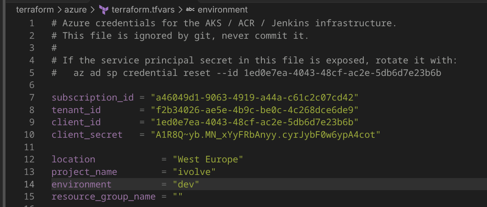
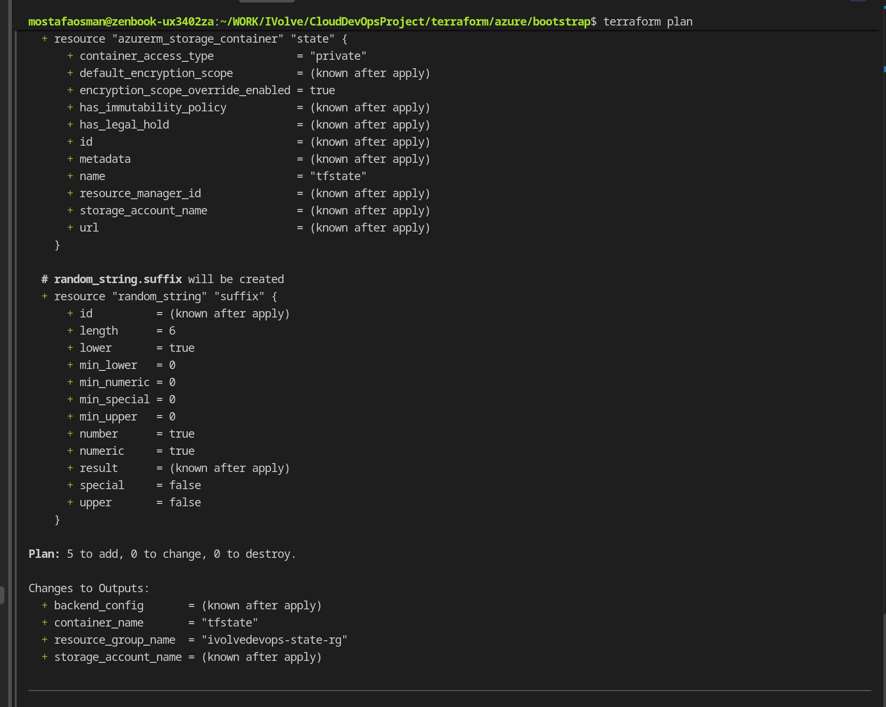
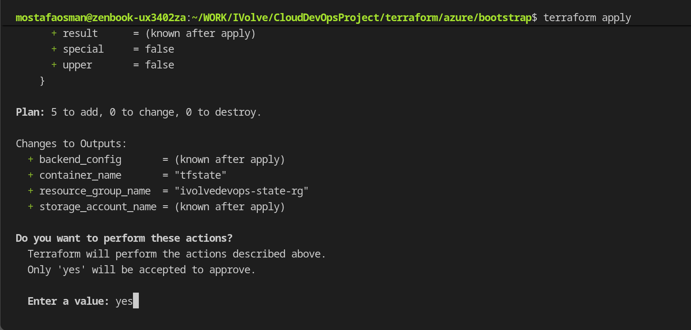
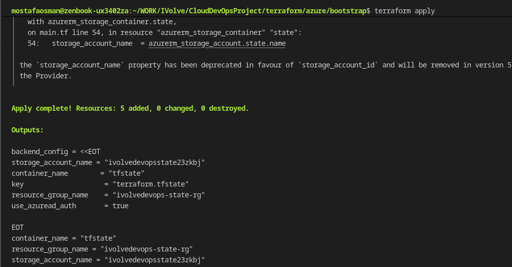

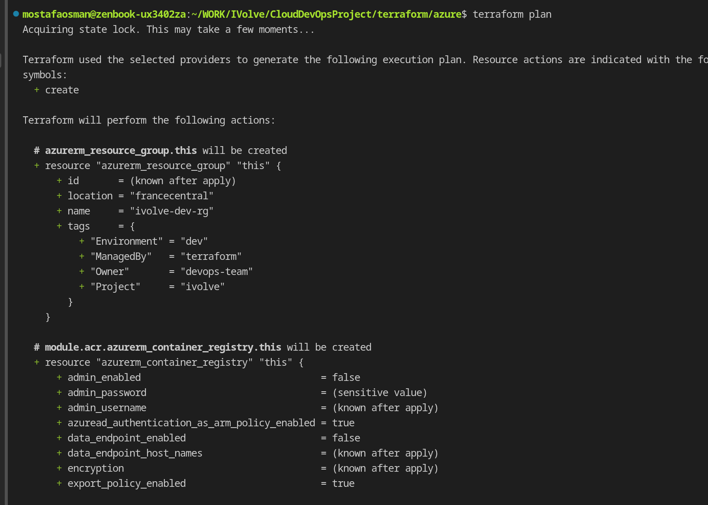

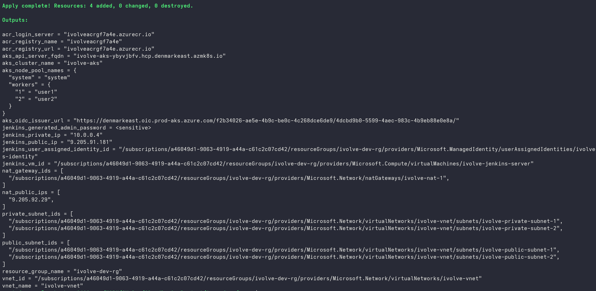
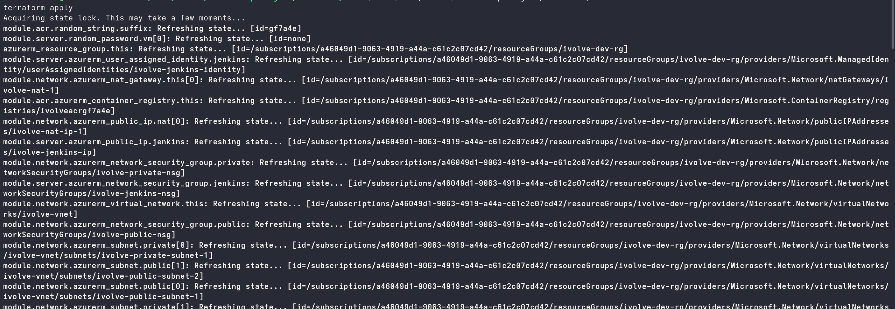
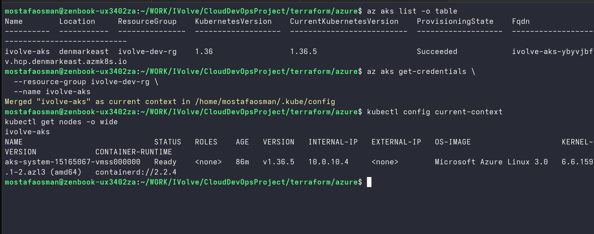

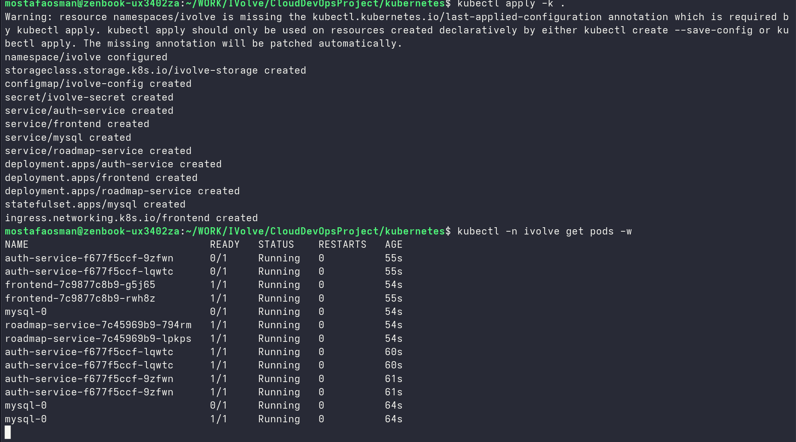
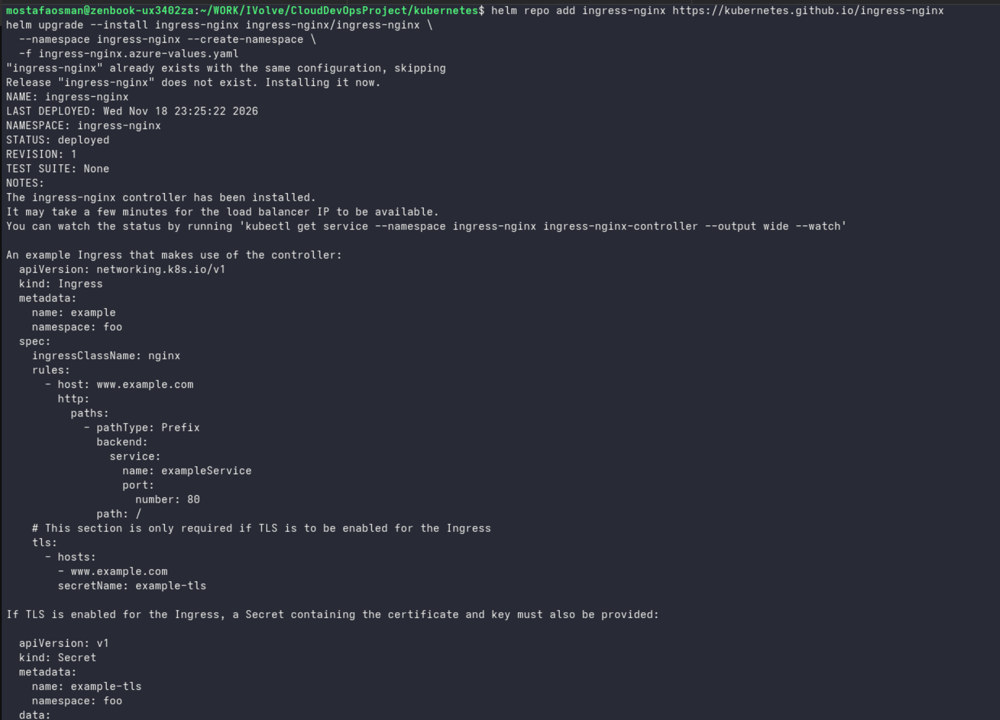
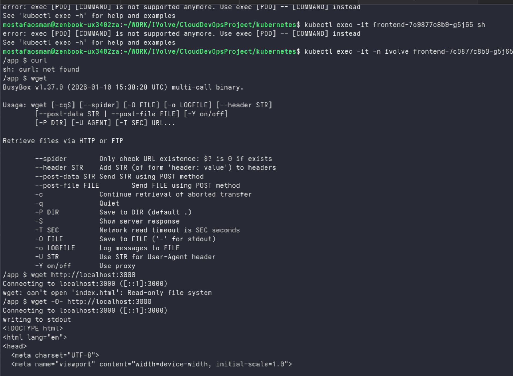

For the finished architecture rather than the build history, see
[the AWS-style diagrams](../../docs/aws-architecture/README.md) and
[the Azure diagrams](../../docs/diagrams/).
